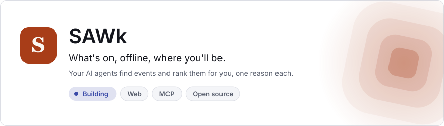
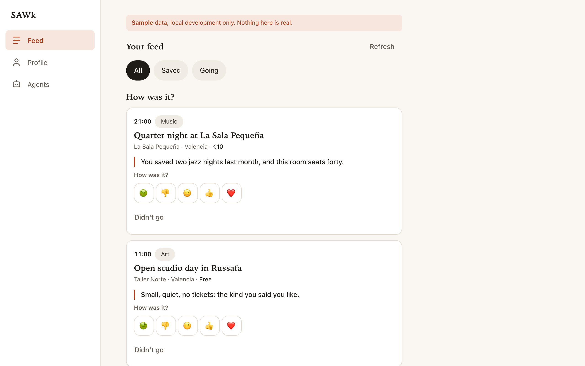
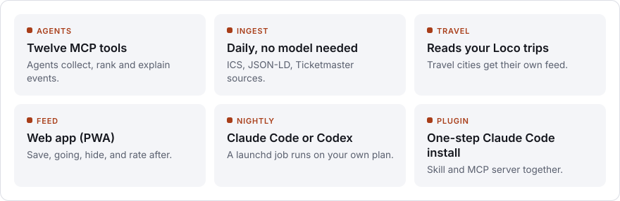
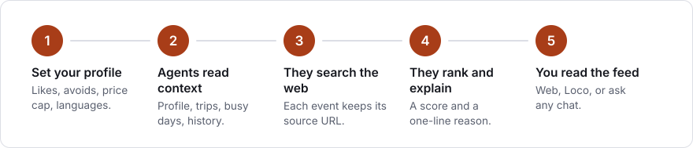

<!-- Pictures: docs/readme/spec.json, drawn by readme-kit. Do not edit the SVGs by hand. -->
<picture><source media="(prefers-color-scheme: dark)" srcset="docs/readme/hero-dark.svg"></picture>

**For the socially awkward: events picked for you, with one reason each, in every city you'll be in.**

SAWk keeps a personal feed of offline events (concerts, talks, meetups, exhibitions, markets, sport) where you live and travel.
Your AI agents do the legwork on a schedule. Status: alpha, one user, built in public.

[Docs](docs/ARCHITECTURE.md) · [Agents setup](docs/AGENTS.md) · [Loco](https://loco.fabriquefutur.com)

<picture><source media="(prefers-color-scheme: dark)" srcset="web/docs/screens/feed-1280x800-dark.png"></picture>

## What it does

<picture><source media="(prefers-color-scheme: dark)" srcset="docs/readme/highlights-dark.svg"></picture>

- **Works with your agents.** Claude Code, Codex, ChatGPT and Grok read your profile and history through SAWk's MCP server.
- **Ask in chat.** Any connected chat answers "what's on tonight?".
- **A floor without agents.** The daily ingest ranks by your tags, so the feed is never empty.

## How it works

<picture><source media="(prefers-color-scheme: dark)" srcset="docs/readme/steps-dark.svg"></picture>

- **Agents rank, the server stores.** No model is called server-side; scheduled runs use your own subscriptions.
- **One context for every agent.** `sawk_context` returns your profile, where you'll be (home and trips), your busy days, your taste and your history, so Claude and ChatGPT rank by the same facts.
- **Self-hostable.** Everything lives in schema `sawk` of any Supabase project. Loco integration turns on by itself when Loco's tables are present.

## Quick start

```
git clone https://github.com/zaitsew/sawk && cd sawk
cp .env.example .env          # SUPABASE_URL, DATABASE_URL (+ optional TICKETMASTER_API_KEY)
deno task migrate             # creates schema `sawk` in your Supabase project
supabase functions deploy sawk sawk-ingest --no-verify-jwt
./check.sh                    # tests and what is still missing
```

`./check.sh` is the first-run check: it prints what is still missing. Then connect an agent: [docs/AGENTS.md](docs/AGENTS.md).
In Claude Code the skill and the MCP server install as one plugin:

```
export SAWK_URL=https://<ref>.supabase.co/functions/v1/sawk
claude plugin marketplace add zaitsew/sawk && claude plugin install sawk@sawk
```

The web feed is a Vite PWA in `web/`. Try it with sample data, no backend:

```
cd web && npm install && VITE_SAWK_MOCK=1 npm run dev
```

For a real build, set `VITE_SUPABASE_URL` and `VITE_SUPABASE_ANON_KEY`. For the nightly agent run: `scripts/run-nightly.sh --dry-run` prints what it would do, and `scripts/launchd/` holds the 05:15 job template.

## Status and licence

Alpha, one user. Built in public. Apache-2.0, see [LICENSE](LICENSE).

## Docs

| Document | What is in it |
|---|---|
| [docs/ARCHITECTURE.md](docs/ARCHITECTURE.md) | Parts, auth, the MCP tools |
| [docs/DECISIONS.md](docs/DECISIONS.md) | Why it is built this way |
| [docs/AGENTS.md](docs/AGENTS.md) | Connecting Claude Code, Codex, ChatGPT, Grok |
| [docs/SOURCES.md](docs/SOURCES.md) | Event sources and the daily ingest |
| [docs/LOCO.md](docs/LOCO.md) | Loco integration |

<details>
<summary>⌖</summary>

**A hare crossing the stubble field** · today 07:12 · free · score 0.97

*You rated two dawn walks 5 of 5. No ticket, no queue, and it ends the moment you reach for your phone.*

<kbd>save</kbd> <kbd>going</kbd> <kbd>hide</kbd>

Not on Meetup, Eventbrite or Songkick. SAWk will never find this one for you.

</details>

<sub>Built by <a href="https://github.com/zaitsew">zaitsew</a> with a fleet of AI agents.</sub>
